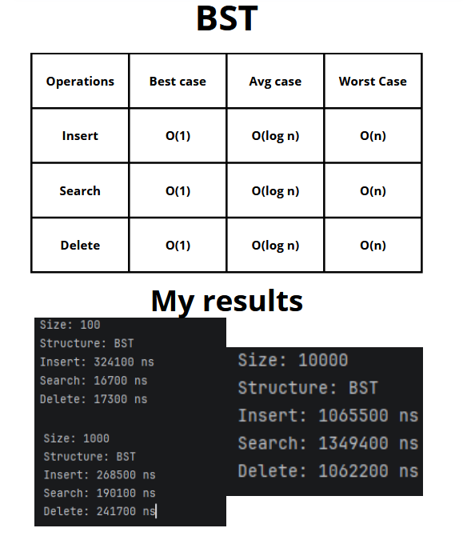
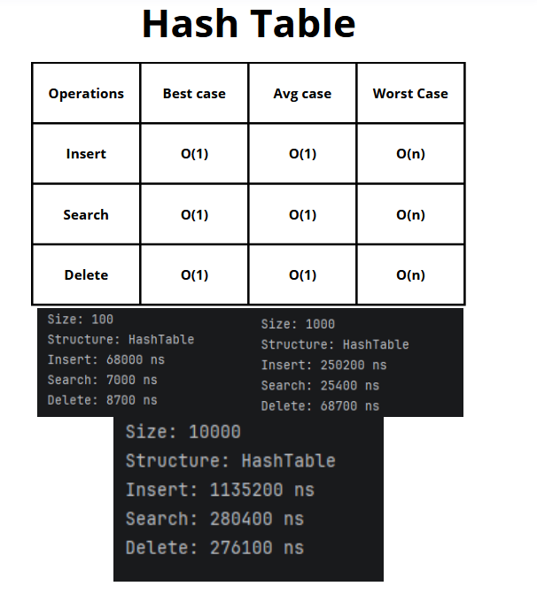

## BST AND HASHTABLE COMPARISIONS:

## Goal of the Project:

- Implement BST and Hash Table.
- Compare insertion, searching, and deletion.
- Compare experimental results with theoretical complexities.
- Test both structures with 100-1000-10000 values.

## BST

In Binary search tree values is stored in nodes, smaller values goes to the left and bigger goes to the right.

The average complexity of insertion, searching, and deletion is O(log n). 

It happens when the tree has a good shape.

The worst-case complexity is O(n) when the tree becomes similar to a linked.

In my experiments, searching and deletion became slower when the number of values increased.
It matches with its theoretical complexity 

Insertion with 100 values was slower than 1000 values , maybe it was caused by system processes, but its not very stable so insertion of bigger numbers was necessary.

In next level that is 10000 values it took millions of nanoseconds, this shows that number of visited nodes 
affected overall performance

## Hash Table

So the main idea of Hash table is to store values in buckets, and each number has index, and if several numbers have the same index they just store in one Linked List.

This is called a collision.

And if table is full on 75 percent it increase its size and move elements to larger array,
it's called resize method.

The average complexity of insertion, searching, and deletion is O(1). 
The worst-case complexity is O(n) when many values are stored in the same bucket.

In my results searching and deletion were faster than in the BST. 
This matches theoretical complexity because the Hash Table calculates the bucket index directly.

Insertion with 10,000 values was a little bit slower than BST. 
More likely it was caused by resize method that moved old elements to larger array.

## Comparisons
As we can see in results For 100 and 1,000 values, the Hash Table was several times faster. 

For 10,000 values, BST insertion was 1065500 ns, while Hash Table insertion was 1135200 ns.
BST was a little bit faster in this operation.

But Hash Table searching and deletion was much faster. 
For 10000 values, BST searching was 1349400 ns, while Hash Table searching was only 280400 ns.
This really shows difference between Constant O(1) and O(log n) complexities.

The experiment mostly matches the theoretical complexity. Hash Table has O(1) average complexity, while BST has O(log n) average complexity. 
But real execution time also depends on resizing, tree shape,JVM performance, and other programs on computer.
So results was slightly affected by these factors.

## Conclusion 
The Hash Table showed better performance for searching and deletion. BST insertion was near in results, but its performance depends on the tree shape.
Balanced tree's gives us O(log n), but If values are inserted in sorted order tree can become similar to a linked list, This leads to the worst case complexity O(n).
So Hash Table is better for fast exact-value operations, BST is useful when values must stay ordered.
As I said before results might be affected by other programs and JVM performance, but overall comparisons was near to the real results.

